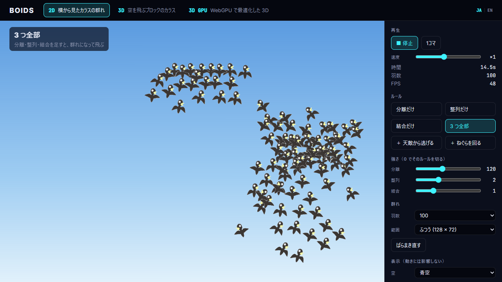
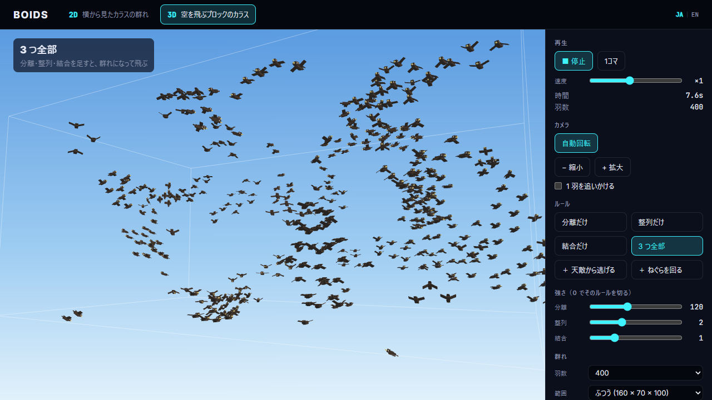
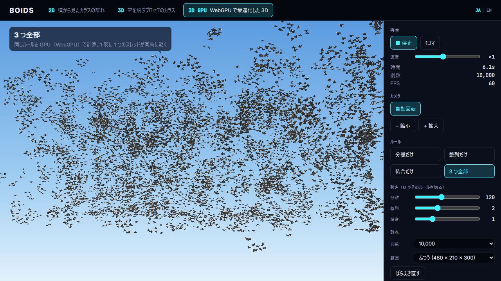

English | [日本語](README.md)

# Boids — 2D / 3D

A flocking simulation, "Boids", built with Three.js. A flock of crows flies across a blue or dusk sky.\
The menu at the top switches between 2D, 3D and 3D GPU.\
Featured on the YouTube channel "Elekibear Digital Lab".

| | | |
|---|---|---|
|  |  |  |
| **2D** — A flock of crows seen from the side | **3D** — A flock of crows made of blocks | **3D GPU** — 10,000 crows computed with WebGPU |

## Features

- **Try the rules one at a time** (separation only, alignment only, cohesion only, all three)
- **Add more rules**
  - Flee a predator (2D: the cursor, 3D: a hawk)
  - Swirl around the roost
- Change the weight of each rule with a slider (0 turns the rule off)
- Choose the number of crows (2D: 50–800, 3D: 100–1600)
- Choose how big the area is, from 4 sizes
- Choose a blue sky or a dusk sky
- Show what one crow sees: the distance of each rule, and the crows in view
- In 3D, turn the camera, or follow one crow
- **3D GPU**: the same three rules computed in a WebGPU compute shader, for tens of thousands of crows (an optimization example)
- An FPS display, to compare the CPU and the GPU

## Tech stack

- React 19
- TypeScript
- Vite
- Three.js
- Vitest
- Prettier

## Getting started

**Requirements**

- [Node.js](https://nodejs.org/) 22.12 or later

In the repository folder, run:

```bash
npm install
npm run dev
```

Open the URL it prints (usually `http://localhost:5173/`) in your browser.

Press "JA | EN" on the top right, or add `?lang=en` to the URL, for English. End the URL with `#3d` to open the 3D screen, or `#3d-gpu` for the 3D GPU screen.

The 3D GPU screen uses WebGPU. Please open it in the latest Chrome or Edge.

## Keys

| Key | Action |
|---|---|
| Space | Play / stop |
| → | Step one frame |
| 1–6 | Choose a rule set |
| R | Scatter again |
| V | What one crow sees |
| M | Switch 2D → 3D → 3D GPU |
| A | Auto-rotate (3D) |
| F | Follow one crow (3D) |
| + / − | Zoom in / out (3D) |

## Folders

```
src/
  core/      The Boids logic. Start reading here
  data/      Rule presets
  view2d/    The 2D screen
  view3d/    The 3D screen
  view3dgpu/ The 3D GPU screen (WebGPU)
  ui/        Parts shared by 2D and 3D
  shared/    Keyboard, language and sky colors
tests/       Tests
```

## Where to read

The Boids logic is in `src/core/`. It doesn't depend on any framework, so reading it shows how it all works.

1. **[`src/core/boids2d.ts`](src/core/boids2d.ts)** — the three rules → add them up → move one step
2. **[`src/core/boids3d.ts`](src/core/boids3d.ts)** — the 3D version in the same order. The rule functions are exactly the same as in 2D
3. **[`src/core/params.ts`](src/core/params.ts)** — view distances, weights and speed limits
4. **[`src/core/boids3d.wgsl`](src/core/boids3d.wgsl)** — the 3D version written for the GPU (WGSL), with its functions in the same order as `boids3d.ts`

Each of the three rules is a function that looks at the crows nearby and returns one force.

```ts
// Separation: move away from crows that are too close
separation(self, others, radius)  // average of (me − them) / distance²
// Alignment: fly the same way as the crows nearby
alignment(self, others, radius)   // their average velocity − my velocity
// Cohesion: move toward the center of the crows nearby
cohesion(self, others, radius)    // their average position − my position
```

Each one times its weight, added up, is the "steering force". `step` adds it to the velocity, keeps the speed between the limits, then moves the position.

The 2D and 3D files are in the same order, so side by side you can read what changes in 3D (only a z is added to the vectors).\
The screens (`src/view2d/`, `src/view3d/`) only draw the results of `core` with Three.js.

## CPU and GPU

The CPU rules are written plainly, for reading. They move one crow after another, so more crows, or a tighter flock with more crows nearby, make them slower.

The 3D GPU screen has the same rules in `src/core/boids3d.wgsl`, with one GPU thread per crow, all running at once. Each crow still checks every other crow, as on the CPU, yet tens of thousands fly smoothly. The flock never leaves the GPU: the renderer reads it directly (`src/view3dgpu/scene/`).

## References

- Craig W. Reynolds, "Flocks, Herds, and Schools: A Distributed Behavioral Model", *SIGGRAPH '87* (1987)
- [[Unity] Simulating a School of Fish Using the Boids Algorithm](https://elekibear.com/en/post/20240528_01_unity_boids) (a post on the same channel's blog; the core logic follows its order)

## Assets

The crow pictures were drawn for Elekibear's game "Goroyan".

## Documents

- [Code guide](docs/code_guide.md) (Japanese) — rules for changing the code
