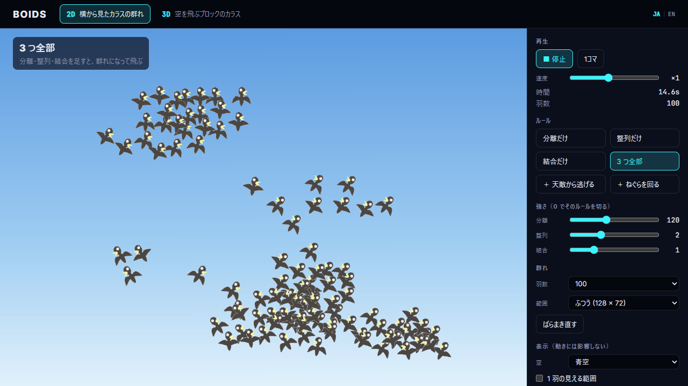
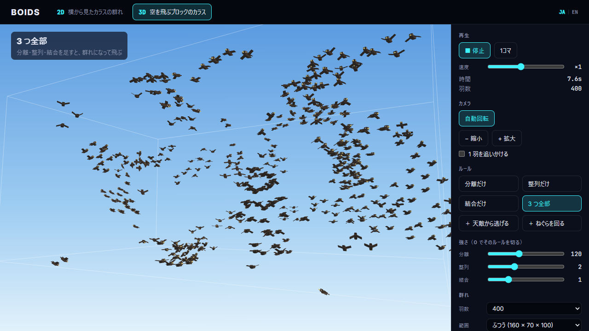

[English](README.en.md) | 日本語

# Boids — 2D / 3D

群れのシミュレーション「Boids」を Three.js で作ったサンプルです。青空や夕焼けの空を、カラスの群れが飛びます。\
画面上部のメニューで 2D と 3D を切り替えて遊べます。\
YouTube チャンネル「エレキベアのデジタルラボ」で紹介しています。

| | |
|---|---|
|  |  |
| **2D** — 横から見たカラスの群れ | **3D** — ブロックで組んだカラスの群れ |

## できること

- **ルールを 1 つずつ試せる**（分離だけ・整列だけ・結合だけ・3 つ全部）
- **ルールを足せる**
  - 天敵から逃げる（2D はカーソル、3D はタカ）
  - ねぐらのまわりを渦を巻いて回る
- 3 つのルールの強さを、スライダーで変えられる（0 にするとそのルールが切れる）
- カラスの数を選べる（2D は 50〜800 羽、3D は 100〜1600 羽）
- 飛ぶ範囲の広さを 4 段階から選べる
- 空を青空と夕方から選べる
- 1 羽の見える範囲（ルールごとの距離）と、見えている仲間を表示できる
- 3D はカメラを回せる。1 羽を追いかけることもできる

## 技術構成

- React 19
- TypeScript
- Vite
- Three.js
- Vitest
- Prettier

## 起動方法

**必要なもの**

- [Node.js](https://nodejs.org/) 22.12 以上

リポジトリのフォルダで、次のコマンドを実行します。

```bash
npm install
npm run dev
```

表示された URL（通常は `http://localhost:5173/`）をブラウザで開きます。

右上の「JA | EN」を押すか、URL に `?lang=en` を付けると英語で表示します。末尾を `#3d` にすると 3D の画面から開きます。

## キー操作

| キー | 操作 |
|---|---|
| Space | 再生 / 停止 |
| → | 1 コマ進める |
| 1〜6 | ルールを選ぶ |
| R | ばらまき直す |
| V | 1 羽の見える範囲 |
| M | 2D / 3D の切り替え |
| A | 自動回転（3D） |
| F | 1 羽を追いかける（3D） |
| + / − | 拡大 / 縮小（3D） |

## フォルダ構成

```
src/
  core/      Boids のコアロジック。まずここを読む
  data/      ルールのプリセット
  view2d/    2D の画面
  view3d/    3D の画面
  ui/        2D と 3D で共通の部品
  shared/    キーボード操作・言語・空の色
tests/       テストコード
```

## コードの読みどころ

Boids のロジックは `src/core/` にまとまっています。フレームワークに依存しない処理なので、ここを読むと仕組みが分かります。

1. **[`src/core/boids2d.ts`](src/core/boids2d.ts)** — 3 つのルール → 足し合わせ → 1 ステップ進める
2. **[`src/core/boids3d.ts`](src/core/boids3d.ts)** — 同じ順に並べた 3D 版。ルールの関数は 2D と一字一句同じ
3. **[`src/core/params.ts`](src/core/params.ts)** — 見える距離・強さ・速さの上限

3 つのルールは、どれも「近くの仲間を見て、力を 1 本返す」だけの関数です。

```ts
// 分離: 近すぎる仲間から離れる
separation(self, others, radius)  // 「自分 − 仲間」を距離² で割って平均
// 整列: 近くの仲間と同じ向きに飛ぶ
alignment(self, others, radius)   // 仲間の速度の平均 − 自分の速度
// 結合: 近くの仲間の真ん中へ向かう
cohesion(self, others, radius)    // 仲間の位置の平均 − 自分の位置
```

それぞれに強さを掛けて足したものが「操舵力」です。`step` はそれを速度に足し、速さを上限と下限の間に収めてから、位置を進めます。

2D と 3D のファイルは同じ順に並べているので、横に並べると「3D で何が変わったか」がそのまま読めます（ベクトルに z が増えるだけです）。\
画面（`src/view2d/`・`src/view3d/`）は、`core` の結果を Three.js で描いているだけです。

## 参考

- Craig W. Reynolds, "Flocks, Herds, and Schools: A Distributed Behavioral Model", *SIGGRAPH '87* (1987)
- [【Unity】Boids アルゴリズムで魚群をシミュレーションする](https://elekibear.com/post/20240528_01_unity_boids)（同じチャンネルのブログ記事。コアロジックの並びをこの記事にそろえています）

## 素材

カラスの絵は、エレキベアのゲーム「ゴロヤン」のために描いたものです。

## ドキュメント

- [コードガイド](docs/code_guide.md) — 手を入れるときの決まり
